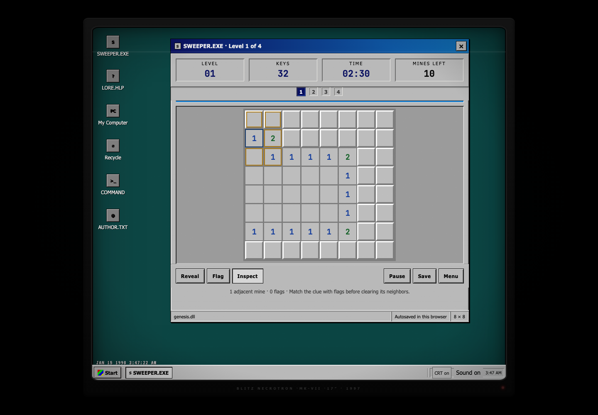
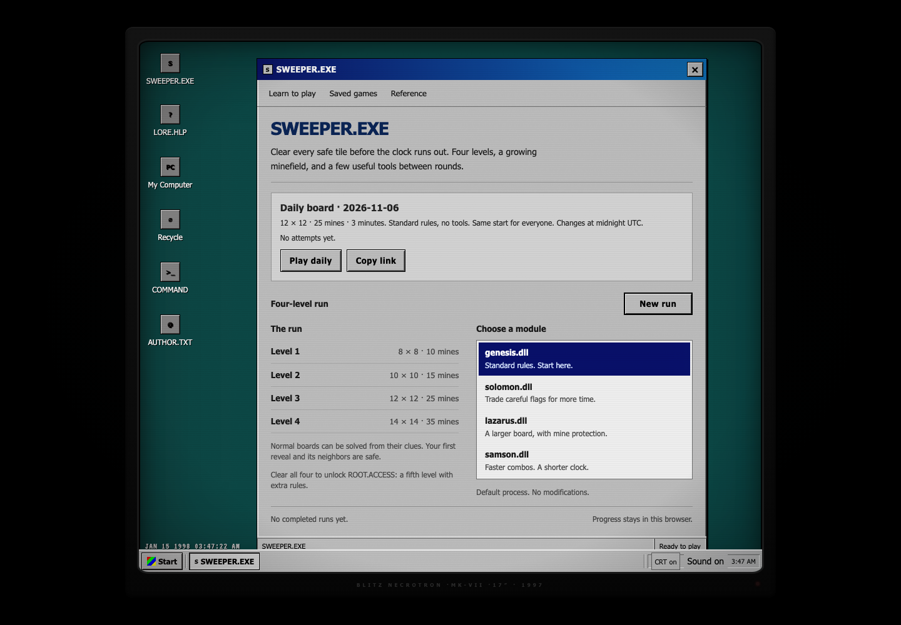

# SWEEPER.EXE

**Live demo: [sweeper.play.thomasou.com](https://sweeper.play.thomasou.com/)**

Timed Minesweeper with four-level runs, a shared daily board, and a Windows 98 desktop.



## Quick Start

```bash
git clone https://github.com/Smokeybear10/300.GAME.sweeper.git
cd 300.GAME.sweeper
python3 -m http.server 2500
```

Open [http://localhost:2500](http://localhost:2500). No package install or build step.

## What It Does

**Learn to play**

A four-step practice board teaches revealing, reading clues, flagging, and clearing neighbors. It has no timer and leaves your saved runs untouched. Open **Learn to play** from the launcher or the practice board in **Reference**.

**The run**

- Clear every safe tile before the timer expires. The first reveal and its neighbors are safe; revealing starts the clock.
- Fresh normal boards are checked for a deduction-only solution. Hard mode, older saved boards, and tools that remove clues are outside that check.
- Finish four levels to unlock ROOT.ACCESS, which adds a fifth level and disruptive board modifiers.
- Earn keys from reveals and combos. Spend them between levels on utilities such as FIREWALL, SCANDISK, and BACKUP, or dependencies with stronger effects and drawbacks.
- Carry 30% of unused time into the next level, rounded down. `lazarus.dll` has no time carry.
- The shop previews the next board, its starting clock, and your carried tools before you continue.

| Level | Grid | Mines | Base time |
|-------|------|-------|-----------|
| 1 | 8 × 8 | 10 | 2:30 |
| 2 | 10 × 10 | 15 | 2:20 |
| 3 | 12 × 12 | 25 | 2:10 |
| 4 | 14 × 14 | 35 | 2:00 |
| 5 · ROOT.ACCESS | 16 × 16 | 50 | 1:50 |

**Daily board**

- One 12 × 12 board with 25 mines and a three-minute clock, changing at midnight UTC. Everyone starts at the marked tile.
- Date-based links reproduce the same board. Copy a link from the launcher or during play; copy a result after finishing.
- Your first result stays saved. Later attempts are labeled practice, with your best completed time kept separately.
- Daily progress has its own autosave. Results and active play time are local to your browser; pauses do not count.



**Modules**

| Module | Effect |
|--------|--------|
| `genesis.dll` | Standard rules |
| `solomon.dll` | First correct flag on each mine adds three seconds; a wrong flag ends the run |
| `lazarus.dll` | A fresh FIREWALL each level, one extra row and column, no FIREWALL purchases or time carry |
| `samson.dll` | A 25% longer combo window, extra combo rewards, and 15% less base time |
| `eden.dll` | Dependency-only shops; each held dependency type slows the timer by 5% |
| `manna.dll` | Double key earnings; lose one key every five seconds |

The first four modules are available immediately. `eden.dll` and `manna.dll` require ROOT.ACCESS.

**Progress**

- Active runs autosave. Choose **Resume level** on the launcher to continue after leaving or reloading.
- **Save** keeps a separate snapshot. Open **Saved games** from the launcher to load or delete manual saves.
- **Review board** shows the finished board after a loss, including misplaced flags and the tile that ended the run.
- **Pause** or **Escape** stops the clock. Switching tabs also pauses the run.
- Saves, unlocks, and run history stay in this browser's local storage. There are no accounts or cross-device saves.

**The desktop**

Draggable windows, a taskbar, a file browser, a terminal, and a help viewer surround the game. **CRT on/off** controls the scanlines and other display effects; reduced-motion preferences default them off. The BIOS sequence only runs when restarting the simulated desktop.

## Controls

| Input | Action |
|-------|--------|
| Click / tap | Use the selected **Reveal**, **Flag**, or **Inspect** mode |
| Right-click / long-press | Place or remove a flag |
| Click a number in Reveal mode | Clear adjacent tiles when its flags match |
| Hover / focus / Inspect | Read a clue and highlight its neighbors without revealing tiles |
| Arrow keys | Move between board cells |
| Enter / Space | Use the selected mode on the focused tile |
| F | Flag the focused tile |
| Escape / Pause | Pause or resume the run |
| Larger tiles | Switch to 44-pixel tiles; scroll to reach the board's edges |
| Utility button | Activate a utility; FIREWALL and BLOATWARE protect automatically |

Tile size, sound, and CRT preferences are remembered in this browser.

## Tech Stack

| Layer | Tools |
|-------|-------|
| Game and UI | HTML, CSS, JavaScript in one file |
| Audio | Web Audio API and MP3 boot sounds |
| Persistence | Browser localStorage |
| Typography | Tahoma, JetBrains Mono, VT323, Space Grotesk |

## Project Structure

```text
index.html              # game, desktop shell, and styles
assets/                 # audio, favicon, and screenshots
DESIGN.md               # Windows 98 / CRT visual system
cis1200/                # original Java Swing game
```

Built by Thomas Ou
